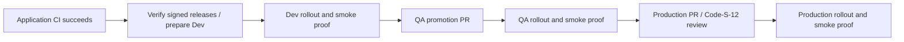

# platform-gitops

Owner: Platform/release.

Desired deployment state for dev, QA and production, including application releases and platform add-ons. A shared service chart and commerce umbrella chart provide digest-only deployment. Argo CD deploys all three environments on the dedicated Narx cluster, using signed private GHCR images.

Project guide: [DOC.md](https://github.com/Narx-Space-Prod/platform-infrastructure/blob/main/DOC.md).

## Current state

The shared chart and capacity profiles are merged. `local/compose.yaml` now provides
a developer preview of the migrated application with PostgreSQL, Redis and an explicit
local payment simulator, persistent ElasticMQ queue/DLQ, outbox publisher and receipt
worker. The background roles reuse the orders image; there are no extra image builds.
It is not the Kubernetes dev/QA deployment or an AWS environment.
All changes after repository initialization go through feature branches and pull requests.
These repositories are public on GitHub Free. Protected `main` requires a CODEOWNER
approval from the designated reviewer team for protected file paths, passing CI checks and resolved conversations; administrators follow the same rules. Only Dev/QA release JSON files are unowned, with trusted verification requiring the dedicated release App as author.

## Chart contract

`charts/commerce-service` provides digest-only images, probes, requests/limits, non-root
containers, rolling updates, optional CPU HPA and an optional PodDisruptionBudget.
Applications must implement its runtime/health contract before deploying through it.
The production profile needs metrics-server. HPA and PDB do not provide AZ resilience
or add worker-node capacity automatically.

`environments/*/values.yaml` contains capacity settings only. No deployable image references
are present. Validation injects a dummy image into rendered output; it is never committed as a release.
`environments/*/runtime.yaml` configures the complete stack; `release.json` is the
canonical immutable image bundle. `applications/local/commerce.json`
registers dev/QA/production on the dedicated `narx-local` cluster after operator bootstrap.
Argo CD runs in the dedicated Narx cluster; the old management cluster is paused. AWS production manifests are retired. `applications/notifications.json` is a data-only
merge patch, not a standalone manifest; use the infrastructure helper to install it.

The reconciler verifies signed main-build records before proposing release/promotion
PRs. The trusted candidate verifier never executes PR code. Dev and QA release PRs merge
automatically after required checks. Production requires code-owner approval and explicit
merge. Failed QA rollouts can propose verified automatic rollback PRs; Production
rollback PRs retain human review; persistent data and SQL migrations are not rolled back. See DOC.md for exact App,
OIDC, credential-refresh and activation steps. All three environments have running workloads. The blanket count is zero, but that alone does not enforce code-owner review. The active native ruleset in `policy/review-ruleset.json` requires one approval from the reviewer team for all paths except the two Dev/QA release files. Keep this ruleset active before applying the zero-count branch setting; never rely on CODEOWNERS alone at count zero. No user or App has a ruleset bypass. Service repository review settings are unchanged.

## Local preview and integration tests

Clone the three application repositories beside this repository, generate `local/.env`
using DOC.md, then run:

```bash
docker compose --parallel 1 --env-file local/.env -f local/compose.yaml build
docker compose --env-file local/.env -f local/compose.yaml up --no-build -d --wait
```

Open `http://localhost:18080`. Backend ports and database ports are not published.
All payments in this preview use the local simulator; no money is charged. PostgreSQL
and queue data persist in named volumes. Carts and simulator state are disposable.

The opt-in test creates throwaway accounts and performs a local SQL role promotion:

```bash
NARX_LOCAL_TEST=1 NARX_COMPOSE_PROJECT=narx-commerce python3 -m unittest discover -s tests -p test_local_stack.py -v
```

It checks authentication, admin restrictions, INR prices, cart/stock, idempotent checkout,
payment verification, customer order isolation, product concurrency checks, order status,
refund retries and sales reporting. Run it only against this disposable preview.

For the separate queue failure exercise, follow DOC.md. Set `NARX_QUEUE_TEST=1` only
on a fresh disposable project: it stops/restarts that project's queue/worker and
injects database failures to verify transaction rollback, retries, duplicates and DLQ
recovery. Regular customer-flow tests do not stop services or inject these constraints.
Real AWS queue policies, IAM, monitoring alarms and production redrive remain pending.

## Required release-policy check

`narx/release-verification` is reported automatically on each PR by the trusted base
workflow. It fetches candidate release JSON as data, verifies source and environment
evidence, and never executes candidate scripts. Changes without release JSON still
receive a successful policy status after the trusted inspection. Deployable release
changes remain blocked until GHCR verification is activated. Main branch protection
requires this status once its first live PR run has been verified.

## Dedicated local cluster and shared Argo CD

The local ApplicationSet generates dev/QA/production Applications in `narx-local`,
restricted by a dedicated AppProject to this repository and three commerce namespaces.
Only Argo CD is shared with the older Boutique project. See the infrastructure guide
for kind creation, namespace bootstrap, scoped cluster registration and CRD installation.
The destination manifest is operator-applied; merging does not retarget live Applications.

Production now uses local PostgreSQL, Redis and ElasticMQ with no AWS Pod Identity.
Its frontend keeps two replicas and blue-green Rollouts; backends use the chart's
single-replica defaults for laptop capacity. HTTP/loopback preview is a lab access mode.
The retired AWS Application must not also manage `commerce-production`.

`monitoring/local-values.yaml` is retained from the earlier shared monitoring integration.
An independent Narx monitoring deployment and removal of the old Boutique integration
remain pending. Do not apply Boutique's monitoring Application as Narx bootstrap.

Real runtime activation is still blocked: publishing/verification use GHCR and remain disabled pending service caller merges, private package access and release/observer App setup. Empty
release files are not working app deployments. Existing policy and platform tests remain
part of CI; no mutable or fictional images should be committed to activate the stack.

## GHCR activation

Release facts accept only `ghcr.io/narx-space-prod/commerce-COMPONENT` with a digest.
Verification binds the signed digest, source repository/main commit, successful caller
CI and an explicitly reviewed shared builder SHA; promotion does not rebuild images.
Registry authentication uses GitHub's ephemeral token with packages:read, not AWS roles.
Private packages must grant this GitOps repository Actions read access, and the cluster
needs its own ghcr-pull secret. The infrastructure helper provisions that separately.

The shared publisher is merged at ba41b7532a626ba47e9bf7b74ba56c4a6808228a;
policy/builders.json trusts that reviewed revision. Service callers must pin it before activation. Existing ECR release facts are rejected; current states
are empty bootstraps, so no live ECR releases require migration.

Release App credentials belong in the main-only gitops-release environment. Read-only
trusted PR verification uses only its ephemeral packages:read token; it does not bind
the release-key environment or execute candidate scripts. Remove repository-level App
key copies after the reviewed workflow/caller cutover so branch workflows cannot read
them. Empty bootstrap Applications cannot report a successful deployed-image status.

Local QA and production use a namespaced CiliumNetworkPolicy to let only the Rollouts controller reach the kube-apiserver identity on TCP 443/6443. CIDR policies do not select node-hosted API endpoints under Cilium defaults. The existing CI custom-resource schema lookup is schemas/argo; ciliumnetworkpolicy.json there is extracted from the v1.20.4 Cilium CRD at https://raw.githubusercontent.com/cilium/cilium/v1.20.4/pkg/k8s/apis/cilium.io/client/crds/v2/ciliumnetworkpolicies.yaml so CI validates the policy without skipping unknown kinds.

## Release ownership

Source PRs require independent review. The master creates Dev/QA release PRs, which auto-merge after trusted checks without human approval. Production release PRs require code-owner approval and explicit merge. Owned platform changes also require review. There is one normal release controller: Commerce CI/CD.

Promotion uses trusted smoke evidence for the exact immutable bundle and current environment configuration. New configuration, pending/failure evidence and untrusted status authors block advancement. Recovery proposes only verified previous image bundles; SQL migrations and persistent data are not automatically reversed.

## Bounded frontend autoscaling

The metrics API has been verified on the Narx cluster. QA frontend HPA is bounded to 1–2 replicas; production to 2–3, targeting 70% CPU request utilization. Scale-up adds at most one pod per minute, and scale-down waits five minutes before removing at most one per minute. Dev and the other services keep fixed replicas. This is a laptop capacity profile, not a production throughput claim.

HPA scales the Rollout through its scale subresource. Helm omits replicas while HPA is enabled, and the local ApplicationSet ignores only the named frontend Rollout replica field with RespectIgnoreDifferences enabled. Image and pod-template drift remain enforced. After reviewed activation, verify HPA conditions/metrics, observe a bounded QA-only load exercise, then confirm scale-down and that Argo remains Synced. The initial configuration is not evidence that this live test passed.

Probe budgets explicitly allow five seconds for health checks and five minutes for application/controller startup. This prevents brief host stalls from immediately becoming restart cascades; it does not add capacity or hide HTTP health failures. The first 500-attempt/s QA exercise scaled 1→2→1 but had failed requests and host-wide pressure/restarts, so it did not pass cleanly. The follow-up QA fixture is capped at 200 attempts/s/four concurrent requests. Reserve host headroom before repeating it. Probe changes roll affected pods, including single-replica data services; apply in a maintenance window.

Service updates use Argo sync waves: Orders API → cart → catalogue → publisher → worker → frontend, after the existing data/controller waves. Orders readiness depends on the database/queue; catalogue and frontend wait on upstream APIs. This limits concurrent Deployment surge to one role and avoids dependent previews consuming the quota needed by their upstream replacement. The frontend retains blue-green preview and active analysis. Rollout progress allows ten minutes, longer than the five-minute startup allowance. This orders GitOps changes; a laptop reboot still starts existing pods together, and host capacity must still be reserved.

Live checkpoint, 2026-11-06: the reviewed 200-attempt/s QA fixture completed 15,401 requests with zero failures; HPA scaled 1 → 2 → 1 and no application/monitoring container restart increases were observed during the exercise. Dev application clients were temporarily paused with operator approval to reserve laptop capacity; data services stayed running, and Dev was restored afterward. This verifies bounded autoscaling mechanics and that availability check, not simultaneous three-environment peak capacity or rollback recovery.


The opt-in Rollouts recovery fixture can reuse an already verified, immutable frontend artifact cached on **every** node of the selected kind cluster:

```bash
NARX_ROLLOUT_TEST=1 NARX_KUBE_CONTEXT=kind-narx-commerce \
NARX_ROLLOUT_IMAGE=ghcr.io/narx-space-prod/commerce-frontend@sha256:d6390f4248ee46d583f8b9fef273ed5f02cca5a567a8df3047d656f4f772513d \
python3 -m unittest discover -s tests -p test_rollout_local.py -v
```

The harness refuses mutable registry tags, missing cached images and an existing `narx-rollout-validation` namespace. It creates a fresh restricted namespace, uses the artifact only as a Node runtime for a synthetic service, exercises preview rejection, post-switch traffic recovery and healthy promotion, then removes the namespace. It does not modify Dev/QA/production releases or claim to verify full GitOps bundle rollback, application checkout or payment recovery. Reserve host headroom first. The local `narx-local/frontend:dev` path remains available for the original developer fixture.

Recovery mechanics checkpoint, 2026-11-06: the isolated fixture passed preview rejection with stable traffic retained, observed the bad post-switch candidate serving before automatic recovery to stable, and promoted a healthy replacement through both analyses. The run completed in 342 seconds and its namespace was confirmed deleted. Dev clients were temporarily paused for capacity; QA and production releases were unchanged. This is direct Rollouts traffic-recovery evidence, separate from end-to-end GitOps bundle rollback.

## Public storefront origins

The local profiles use `global.publicAccess.origin` and `global.publicAccess.secureCookies` for the Cloudflare HTTPS entry points: `https://narx-dev.narx.space`, `https://narx-qa.narx.space`, and `https://narx-prod.narx.space`. Those values render into commerce-settings and their checksum changes only Frontend pods, so updated origin checks and cookie flags take effect without Java service restarts. Older profiles without publicAccess retain the existing top-level values. After enabling secure cookies, use the public HTTPS URL for login and checkout. See platform-infrastructure/local/access.json and its systemd template for persistent loopback origin ports. The origin and DNS route must agree exactly for state-changing API requests.

## Event-driven promotion and recovery

Protected source CI emits release-published; a signed GitHub push webhook refreshes Argo when GitOps changes merge. The observer posts deployment evidence on the revision actually synced. Only success/failure status events from the trusted observer App and the three deployment contexts can trigger promotion; required health, signature and review gates still apply. Scheduling remains a fallback. Configure the webhook using the reviewed infrastructure bootstrap helper and permit only Argo's signed `/api/webhook` endpoint through any interactive Cloudflare Access policy. Slack uses the named webhook subscription (`.slack: ""`), with its credential kept in the existing Kubernetes Secret. The release bot waits for GitHub to expose its expected PR head and retries the exact-head auto-merge operation within a bounded window; it never accepts another head or auto-merges production.

## Delivery timing and bounded capacity

Java Orders, Publisher and Worker stay in separate sync waves. Their CPU ceilings
are one core, with the existing 448/320/320 MiB memory limits preserved. This uses
available CPU during startup rather than overlapping Java memory peaks. Cart and
Catalogue share a lightweight wave; the render tests check aggregate surge memory
against namespace quotas, including maximum frontend HPA replicas. Readiness,
startup, smoke and progressive-delivery checks remain enabled.

Image provenance and SBOM success can be reused within one reconciliation process
only for the identical digest, source/run identity and reviewed builder policy.
The cache is in memory, stores only successful checks and is discarded between
invocations. Changed sources, digests or builder policies require verification
again. No persisted verification cache or skipped environment health evidence is
introduced. Preserve old reviewed builders for existing releases and rollbacks.

## Operator pipeline entrypoints

Application repositories expose **01 - Application CI**, a single call to the
shared `platform-ci/application.yml` wrapper. Open its graph to follow source
policy → test/coverage/image scan → Sonar → signed publication → delivery handoff.
Each source repository still owns its PR checks; the shared wrapper removes
repeated orchestration rather than coupling unrelated source changes.

Open **[02 - Commerce Delivery](https://github.com/Narx-Space-Prod/platform-gitops/actions/workflows/delivery.yml)**
to follow the central release graph:



The Dev and QA jobs wait for the exact immutable bundle and successful smoke
statuses from the dedicated observer App. They do not use a fixed sleep as proof,
do not call Argo sync manually, and have no cluster credentials. Promotion jobs
reuse the existing canonical-bundle, source-CI and signed-attestation policy.
Source dispatches include their CI run ID; intake waits for completed successful
CI before selecting releases. Queued intakes coalesce and read fresh state. An
hourly fallback catches missed source events without generating five-minute
normal-delivery runs or a new delivery run for every deployment status.

The current Production PR review gate remains unchanged. The automatic graph
ends by requesting that PR; its body links back to the central delivery graph and
lists source CI runs. After review and merge, **the same Commerce Delivery
workflow** opens a Production continuation run and checks the actual deployment.
The summary distinguishes requesting approval from successful deployment. This
avoids an idle runner while waiting for human review. A single uninterrupted
run would require deliberately moving the approval to a protected GitHub
Production environment; that is a separate approval-policy choice.

**[03 - Recovery](https://github.com/Narx-Space-Prod/platform-gitops/actions/workflows/recovery.yml)**
is the manual rollback entrypoint. It also responds only to trusted failed QA or
Production deployment statuses, and rechecks the current failure before proposing
a rollback. Dev/QA PR auto-merge and Production code-owner review still apply.
Normal delivery and recovery share one reusable privileged release-stage setup;
read-only deployment waits cannot mint release tokens. An observed timeout,
failure or superseded upstream cannot authorize promotion.

Platform/library PR validation and the trusted base-code release verifier remain
supporting checks. They are distinct security responsibilities, not separate
operator deployment entrypoints. Workflow names and the CI/PR summary links are
the navigation starting points; individual reusable files are implementation
building blocks.

## Main pipeline: Commerce CI/CD

Follow [Commerce CI/CD](https://github.com/Narx-Space-Prod/platform-gitops/actions/workflows/commerce.yml), identified by source repository and commit:

**CI tests/security → Sonar → signed publication → Dev verification → isolated business E2E → QA verification → Production approval → Production verification.**

Service CI executes tests and builds; the master verifies versioned JSON evidence tied to the exact repository, commit, run and attempt. It does not duplicate builds. Image signatures and SBOMs are verified separately before promotion. PR checks remain in source repositories. All current callers use evidence v1; job-name matching and the legacy all-in-one reconciler are retired.

The hosted business sandbox pulls exact Dev-verified image digests, uses only a matching payment simulator and disposable local credentials/data, and exercises checkout, refund and queue recovery before QA. It never connects to Kubernetes or live payments; project-scoped cleanup runs even on failure.

Promotion and recovery share the short-lived `release-state-mutation` lock with GitHub's bounded multi-entry queue. CI and Production approval waits hold no writer lock. A superseded release fails closed rather than claiming deployment of a different bundle. The queue is bounded, not an unlimited durable release queue.

Production remains independently approved through its release PR. The master observes merge and trusted smoke evidence for up to one hour; timeout is not approval or deployment success. Recovery retains narrow Production-merge observation for operational fallback. Waiting still consumes a bounded hosted runner.

Reusable workflow files separate source evidence, privileged mutations and read-only rollout observation. Trusted PR verification runs reviewed base code; it never executes candidate PR code. Control scripts stay at the workflow revision while live desired state is read separately from fetched Git.

### Manual recovery

Use Actions → Recovery for an explicit environment rollback, or the reviewed CLI:

```bash
python3 scripts/delivery.py validate
python3 scripts/delivery.py rollback qa
```

Rollback commands require authenticated Git/GitHub, registry verification, configured observer identity and cosign as supplied by the recovery workflow. They propose a checked GitOps PR; Production review is retained. Automatic failure recovery is limited to QA/Production. No schema/data rollback is implied.

The actionlint configuration suppresses only its unsupported concurrency.queue-key diagnostic in delivery-stage.yml; regression tests validate the exact shared queued-lock contract. Other lint checks remain enabled.
